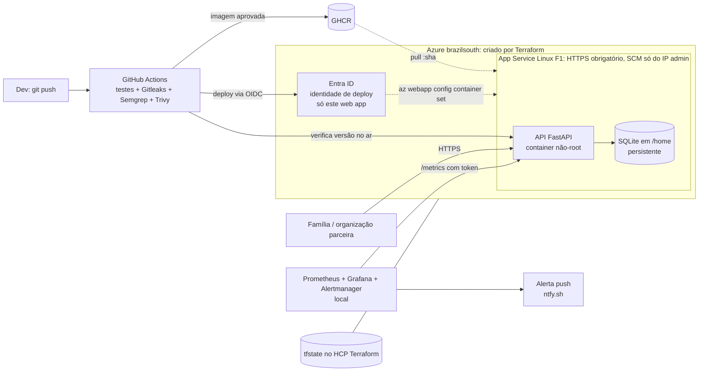

# Conta Clara

Assistente de conta de luz para famílias de baixa renda: a pessoa anota o número do medidor, vê quanto a conta deve dar e confere se a distribuidora cobrou certo. Quando a conta não bate com o medidor, o sistema gera o texto da contestação.
Global Solution FIAP 2026.2 (CitizenTech), 4ES. Este repositório traz o MVP e a entrega de **Secure DevOps Tools & Cloud Computing: Deploy Blindado**.

[](../../actions/workflows/devsecops.yml)

## Ficha Técnica do MVP

| Campo | Conteúdo |
|---|---|
| **Nome do produto** | Conta Clara |
| **Cidadão e território** | Famílias de baixa renda, idosos que moram sozinhos e quem já teve corte ou conta muito acima do esperado. Piloto em bairros da zona sul de São Paulo (SP) atendidos pela mesma distribuidora, com apoio de CRAS e associações de moradores. |
| **Problema, em uma frase** | A família não entende a própria conta de luz, só percebe o problema quando a fatura chega alta e não sabe contestar uma leitura estimada ou errada. |
| **Proposta de valor** | A família acompanha o consumo pelas leituras do medidor, sabe quanto a conta deve dar antes de ela chegar e recebe a contestação pronta quando a cobrança não bate. A organização parceira vê um painel agregado das casas com divergência, sem dado pessoal. |
| **Arquitetura: componentes** | Página web (HTML/JS sem dependência externa) e API FastAPI num container, publicado no Azure App Service (Linux, plano F1 gratuito) criado por Terraform. Banco SQLite no armazenamento persistente do App Service (brazilsouth). CI/CD com GitHub Actions (build, testes, Gitleaks, Semgrep e Trivy) e deploy por OIDC. Observabilidade com Prometheus, Grafana e Alertmanager (alerta push via ntfy.sh). Localmente, Docker Compose (API + Caddy). |
| **Fontes de dados** | (A) Leituras do medidor enviadas pelo próprio MVP. (B) Tarifa residencial e adicional da bandeira tarifária: valores de referência configuráveis, que no produto completo vêm dos dados abertos da ANEEL (componente de Big Data). (C) Open-Meteo (temperatura), no componente de Big Data. A casa de demonstração tem leituras **sintéticas**. |
| **Modelos de IA utilizados** | Leitura do display do medidor por foto (YOLO customizado, componente Applied Computer Vision) e contestação gerada por LLM com RAG sobre as normas da ANEEL (componente Generative AI). Nenhum dos dois faz parte desta entrega de DevOps: aqui o número é digitado e a contestação vem de um modelo de texto fixo. |
| **URL do MVP e repositório** | MVP: https://contaclara-gs.azurewebsites.net. Repositório: https://github.com/ph-tavares/conta-clara |
| **Indicadores de impacto** | Casas ativas, leituras por mês, conferências feitas, conferências divergentes, contestações aceitas pela distribuidora (informado pela família) e valor devolvido por família. Os dois últimos medem impacto; os demais, uso. |
| **ODS conectados** | ODS 7 (energia acessível: metas 7.1 e 7.3), ODS 10 (redução das desigualdades), ODS 11 (moradia digna: meta 11.1) e ODS 13 (consumo e ondas de calor). |

### Integrante

| Nome completo | RM |
|---|---|
| Pedro Henrique Pedrosa Tavares | RM97877 |

## Como usar (cidadão)

1. Abra o MVP e clique em **Ver a casa de demonstração** (leituras fictícias) ou **Começar com uma casa nova**. Não há cadastro: a casa é um código aleatório guardado no aparelho.
2. Anote o número do display do medidor em dias diferentes.
3. Veja o consumo médio por dia, a projeção de 30 dias e a conta estimada.
4. Quando a conta chegar, informe os kWh cobrados. Se a diferença passar de 15%, o sistema mostra o texto da contestação para enviar pelo canal oficial da distribuidora.

## API

| Rota | Função |
|---|---|
| `POST /api/casas` | cria uma casa e devolve o código (o banco guarda só o hash SHA-256) |
| `GET /api/leituras` | leituras da casa e resumo de consumo (cabeçalho `X-Codigo-Casa`) |
| `POST /api/leituras` | anota uma leitura; recusa número menor que o de um dia anterior |
| `POST /api/conferir` | compara a conta com o medidor e gera a contestação se divergir |
| `GET /api/config` | tarifa, bandeira e limite de referência |
| `GET /api/dados/painel` | situação de cada bairro do piloto, vinda da camada Ouro (`workspace.conta_clara.ouro_painel_bairro`), só agregados |
| `GET /api/admin/painel` | painel agregado da organização parceira (token Bearer; sem token → 401) |
| `GET /health` | status e versão publicada |
| `GET /metrics` | métricas Prometheus (token Bearer) |

## Dados do pipeline (componente Big Data)

A seção **Como estão as famílias do piloto** da página lê `GET /api/dados/painel`, que serve `app/dados/ouro_painel_bairro.json`. Esse arquivo é exportado pelo notebook `05_exportar_para_mvp` do repositório [conta-clara-dados](https://github.com/ph-tavares/conta-clara-dados) a partir da tabela Ouro `ouro_painel_bairro` (totais por bairro, sem dado pessoal), no formato do contrato `contrato/ouro_painel_bairro.schema.json` daquele repositório.

## Arquitetura



**Por que App Service e não VM:** a assinatura usada é a *Azure for Students*, com política que só libera cinco regiões (entre elas `brazilsouth`). Uma VM consumiria crédito e exigiria patch do SO e uma porta SSH a proteger. O F1 é gratuito, roda o mesmo container e entrega HTTPS e patches do host pela plataforma.

## Como rodar localmente

Pré-requisito: Docker com Compose v2.

```bash
cp .env.example .env            # troque os valores
docker compose up -d --build    # api + proxy (Caddy)
# abra http://localhost:8080
```

Testes (Python 3.11+; usam um SQLite temporário, sem serviço externo):

```bash
cd app && pip install -r requirements-dev.txt && python -m pytest -q
```

## Deploy na Azure (Terraform)

Pré-requisitos: [Azure CLI](https://learn.microsoft.com/cli/azure/install-azure-cli), Terraform ≥ 1.6 e uma conta gratuita no [HCP Terraform](https://app.terraform.io) (onde fica o state), com um workspace `conta-clara` em *execution mode* `local`.

```bash
az login
az provider register -n Microsoft.Web --wait   # uma vez por assinatura
export TF_CLOUD_ORGANIZATION="<sua organizacao>" TF_WORKSPACE="conta-clara"   # token: terraform login
cd infra/terraform
cp terraform.tfvars.example terraform.tfvars # preencha: subscription_id, admin_cidr (seu IP /32), api_image e github_repo
terraform init
terraform plan -out plano.tfplan
terraform apply plano.tfplan
terraform output app_url
```

- O **state** fica no HCP Terraform, criptografado e versionado. O *execution mode* `local` faz o plano rodar na máquina com o `az login`; só o state vai para o HCP. O `terraform.tfvars` está no `.gitignore`.
- A **porta administrativa** do App Service é o site SCM/Kudu. Ele só aceita o `admin_cidr`, e a ação padrão é negar. A validação em `variables.tf` recusa `0.0.0.0/0` e qualquer faixa maior que /24, e o `terraform test` comprova isso no CI. FTP e publicação por senha estão desligados, e não há SSH.
- Token de admin e token de métricas são gerados pelo Terraform (`random_password`) e entram como *app settings*. Nunca são digitados nem versionados.
- O Terraform cria também a **identidade de deploy** (aplicação no Entra ID com credencial federada OIDC). Ela só aceita o environment `producao` deste repositório (identificado pelos IDs imutáveis do dono e do repositório) e tem o papel *Website Contributor* só neste web app.

### Configuração do GitHub (uma vez)

```bash
gh secret set AZURE_CLIENT_ID       --body "$(terraform output -raw azure_client_id)"
gh secret set AZURE_TENANT_ID       --body "$(terraform output -raw azure_tenant_id)"
gh secret set AZURE_SUBSCRIPTION_ID --body "$(az account show --query id -o tsv)"
gh secret set METRICS_TOKEN         --body "$(terraform output -raw metrics_token)"
gh variable set APP_URL              --body "$(terraform output -raw app_url)"
gh variable set AZURE_WEBAPP_NAME    --body "$(terraform output -raw app_name)"
gh variable set AZURE_RESOURCE_GROUP --body "$(terraform output -raw resource_group)"
```

A imagem `ghcr.io/ph-tavares/conta-clara` precisa ser pública para o App Service puxá-la sem credencial (ver "Package settings" no GitHub, se ela nascer privada).

## Pipeline DevSecOps (`.github/workflows/devsecops.yml`)

| Job | Quando | O que barra |
|---|---|---|
| Build e testes | todo push | regressão funcional (pytest com a API completa) |
| Gitleaks | todo push | segredo em **qualquer commit** do histórico |
| Semgrep | todo push | SAST: Python, Dockerfile, GitHub Actions e segredos (`--error`) |
| Terraform + Trivy (IaC) | todo push | `fmt`/`validate`/`test` + misconfiguração HIGH/CRITICAL |
| Imagem + Trivy | todo push | CVE HIGH/CRITICAL corrigível ou segredo na imagem. Na `main`, publica no GHCR |
| Deploy automático | push na `main` | falha se a nova versão não estiver no ar em 10 min ou se `/metrics` não exigir token |

**Deploy:** só a imagem aprovada em todos os portões é publicada.
1. O job `deploy` faz login na Azure por **OIDC**, com um token de curta duração emitido para o environment `producao`. Não há senha nem chave da nuvem guardada no GitHub.
2. O job aponta o App Service para a imagem `:<sha>` do commit.
3. O job só passa quando `/health` responde com esse SHA.

### Demonstrar uma execução barrada e a corrigida

```bash
git switch -c demo/segredo-vazado
echo "DATABASE_PASSWORD = \"$(openssl rand -base64 18)\"" > app/config_demo.py   # segredo FALSO gerado na hora
git add . && git commit -m "demo: segredo vazado" && git push -u origin demo/segredo-vazado
# → job Gitleaks falha (print da execução barrada)
git reset --hard HEAD~1 && git push --force-with-lease   # correção: remove o segredo do HISTÓRICO
# → pipeline verde (print da execução corrigida); depois apague a branch
```

## Observabilidade (`monitoring/`)

Prometheus, Grafana e Alertmanager rodam **localmente** e raspam o MVP publicado (o enunciado permite):

```bash
cd monitoring
terraform -chdir=../infra/terraform output -raw metrics_token > secrets/metrics_token
sed "s/TOPICO/contaclara-$(openssl rand -hex 8)/" ntfy_url.example > secrets/ntfy_url   # topico aleatorio, fora do git
GRAFANA_ADMIN_PASSWORD='<senha-forte>' docker compose up -d
```

- Grafana: http://localhost:3000, dashboard **Conta Clara - 4 sinais de ouro**: latência (p50/p95/p99), tráfego (req/s por rota), erros (4xx/5xx e % de 5xx) e saturação (CPU, memória, requisições em andamento).
- Alertas (`alertas.yml`): `ContaClaraFora`, `TaxaDeErrosAlta` (>5% de 5xx), `LatenciaP95Alta` (>1 s) e `SaturacaoMemoria` (>200 MB).
- **Disparar um alerta de verdade:** `az webapp stop -g rg-contaclara -n contaclara-gs`. A raspagem falha, o `ContaClaraFora` vai para *firing* em cerca de 1 min e o Alertmanager manda uma notificação push pelo [ntfy.sh](https://ntfy.sh) (basta abrir `https://ntfy.sh/<topico>` no navegador ou assinar o tópico no app do celular). Depois, `az webapp start ...` e chega a notificação de *resolved*. As mensagens levam só o nome do alerta e o host público, nenhum dado pessoal.

## Segurança e LGPD (resumo)

- **Container:** imagem multi-stage, usuário não-root (uid 10001), sem segredo na imagem (o Trivy `secret` confirma). No compose local: sistema de arquivos read-only, `cap_drop: ALL`, `no-new-privileges` e limite de memória.
- **Nuvem:** HTTPS obrigatório com TLS 1.2+. O SCM/Kudu só aceita o IP do admin. FTP e publicação por senha estão desligados. O deploy usa OIDC com menor privilégio.
- **App:** CSP restritiva (só `'self'`, nenhuma biblioteca externa) e `nosniff`. Painel e `/metrics` exigem token Bearer, comparado em tempo constante. Documentação OpenAPI desligada.
- **Dados pessoais:** não há nome, CPF, endereço nem número da instalação. A casa é um código aleatório de 72 bits; o banco guarda só o hash SHA-256 dele, e o código trafega no cabeçalho `X-Codigo-Casa`, nunca na URL (que vai para os logs HTTP). O painel do parceiro só mostra contagens. O banco fica em `/home/data` do App Service, em `brazilsouth` (Brasil).

## Estrutura

```
app/                 API FastAPI, página web, testes e Dockerfile
docker-compose.yml   stack local (api + proxy); override adiciona o build
infra/terraform/     App Service, restrições de acesso e identidade OIDC (Azure) + testes de segurança
monitoring/          Prometheus, alertas, Alertmanager e Grafana
.github/workflows/   pipeline DevSecOps
docs/                relatório (HTML e PDF) e evidências
```

### Gerar o PDF do relatório

Salve os prints em `docs/evidencias/` com os nomes indicados nas figuras de `docs/relatorio.html` e rode (Windows/PowerShell):

```powershell
& "C:\Program Files (x86)\Microsoft\Edge\Application\msedge.exe" --headless=new --no-pdf-header-footer --virtual-time-budget=5000 `
  --print-to-pdf="$PWD\docs\relatorio-deploy-blindado.pdf" "file:///$($PWD -replace '\\','/')/docs/relatorio.html"
```

Figuras sem print aparecem como uma caixa amarela "PRINT PENDENTE".
